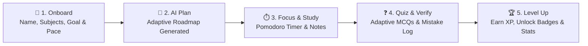

<div align="center">

  

  <br/><br/>

  # 🧠 StudyMind Pro — AI Learning Coach

  **AI-Powered Personalized Learning Platform & Study Companion**  
  *Built for the **AI Product Buildathon | Product Space***

  [](https://studymindpro.netlify.app/)
  [](LICENSE)
  [](https://reactjs.org/)
  [](https://studymindpro.netlify.app/)

  <br/>

  <h3>
    <a href="https://studymindpro.netlify.app/">🚀 Try Live Demo</a>
    <span> · </span>
    <a href="#-key-features">✨ Key Features</a>
    <span> · </span>
    <a href="#-how-it-works">⚙️ How It Works</a>
    <span> · </span>
    <a href="#-tech-stack">🛠️ Tech Stack</a>
    <span> · </span>
    <a href="#-demo-videos--pitch">🎬 Demo & Deck</a>
  </h3>

</div>

---

## 🌐 Live Application

Experience the full application directly in your browser with zero installation:  
👉 **[https://studymindpro.netlify.app/](https://studymindpro.netlify.app/)**

---

## 📌 The Problem

Students struggle without personalized structure, tracking, and feedback:
- 😩 **No Structure**: Students lack adaptive study plans tailored to their pace, target dates, and real goals.
- 📉 **No Tracking**: Progress goes unmeasured — students don't know what to revise or when.
- 🤯 **No Motivation**: Studying alone is demotivating without active feedback loops, streaks, and milestones.
- 🔍 **Fragmented Resources**: Finding high-quality study materials, relevant practice quizzes, and project ideas wastes precious study hours.

> ⚠️ **73%** of students feel overwhelmed during self-study  
> ⚠️ Only **1 in 4** students follows a structured study plan  
> ⚠️ Dropout / abandonment risk doubles without visual progress tracking

---

## 💡 The Solution: StudyMind Pro

**StudyMind Pro** is a zero-dependency, single-file browser application that brings together an AI coach, personalized daily schedules, active recall testing, and gamified productivity tools into a unified workspace.

| Component | Purpose |
|---|---|
| 🤖 **Floating AI Coach** | Conversational tutor with real-time streaming guidance and context awareness |
| 📅 **Smart Study Planner** | Phase-wise learning roadmap with adaptive rescheduling |
| ❓ **AI Quiz Engine** | Unlimited topic-aware MCQs with explanation breakdowns |
| 📊 **Progress Analytics** | Visual heatmaps, completion rates, and XP velocity |
| ⏱️ **Focus Timer** | Pomodoro focus sessions with SVG ring animations & background alerts |
| 🏆 **Badges & Gamification** | Milestone XP rewards, streak tracking, and leveling |
| 📝 **Study Notes** | Topic-linked notes with image/diagram upload support |
| 🌐 **Curated Resources** | Verified YouTube channels, books, documentation, and free courses |
| 💡 **Project Ideas** | Level-tailored applied projects to turn theory into portfolio assets |

---

## ✨ Key Features

### 🤖 Floating AI Coach (Always-On Mentor)
- Accessible from any page via the floating avatar in the bottom-right corner.
- **Context-Aware**: Understands the user's active subject, goal, current level, and completed/missed sessions.
- **Deep Explanations**: Provides step-by-step breakdowns, code snippets, analogies, and verbal quiz drills.

### 📅 Smart Study Planner & Dynamic Rescheduler
- Automatically sequences topics across progressive phases: *Foundation*, *Building Skills*, *Advanced*, and *Polish & Ship*.
- Micro-session chunking (15–20 minute focus bursts) with one-click completion.
- **Dynamic Catch-up**: Shift forward, shrink durations, or blend missed sessions into future days without guilt.

### ❓ Adaptive AI Quiz Engine
- Generates 3, 5, 8, 10, or 15 multiple-choice questions for any specific lesson or custom topic.
- Distinguishes between conceptual understanding, common pitfalls, and real-world edge cases.
- **Mistake Review**: Highlights wrong answers with 2–3 sentence educational rationales.

### ⏱️ Focus Timer (Pomodoro Engine)
- Customizable Deep Work (50m/10m), Classic Pomodoro (25m/5m), Quick Sprint (15m/3m), or custom durations.
- High-performance SVG timer ring with comet-sweep glow animations.
- Browser notifications that alert you when focus or break sessions end.

### 🏆 Gamified XP & Achievement System
- Earn XP for completed sessions (+25 XP), quiz correct answers (+15 XP), and focus sessions (+10–25 XP).
- Unlock 16+ vibrantly styled milestone badges (First Steps, On Fire, Diamond, Champion, etc.).
- Level-up celebrations with full-screen confetti.

### 🎨 Design & Accessibility
- **Dual Themes**: Handcrafted Dark mode and Warm Parchment Light mode.
- Custom SVG avatars with diverse skin tones, hairstyles, and accessories.
- Fully responsive on desktop, tablet, and mobile browsers.

---

## ⚙️ How It Works



1. **👤 Onboard**: Enter your name, target subjects, learning level, goal (Exam, Project, Job, Fun, Upskill), and available hours.
2. **📅 AI Plans**: The AI designs a goal-specific multi-week study schedule with curated resources.
3. **⏱️ Study**: Work through micro-sessions with the built-in Pomodoro timer and attach lecture photos to your notes.
4. **❓ Quiz**: Validate retention after every topic with AI-generated MCQs and explanation feedback.
5. **🏆 Level Up**: Collect XP, level up your profile, unlock badges, and monitor your long-term consistency.

---

## 🛠️ Tech Stack

| Layer | Technology | Details |
|---|---|---|
| **Frontend Core** | React 18.2 (UMD CDN) | Standalone client-side application — zero npm build step needed |
| **Styling & Theme** | Modern CSS3 & CSS Variables | Responsive layout, dark/light theme switching, CSS Grid & Flexbox |
| **Typography** | Google Fonts | Sora (headings), Space Grotesk (body), JetBrains Mono (timer & stats) |
| **Icons & Visuals** | Custom SVG Dictionary | Zero external icon library dependencies; lightweight inline SVGs |
| **Analytics & Charts** | Chart.js 4.4 | Progress rings, phase breakdowns, and session distribution |
| **AI Engine** | LLM API Integration | Streaming chat coach, curriculum generation, and quiz synthesis |
| **Storage & State** | Browser `localStorage` | 100% client-side privacy; multi-student profiles, notes & plans persist locally |

---

## 📁 Repository Structure

```
StudyMind/
├── index.html                   # Main entry point (StudyMind Pro web app v4)
├── studymind-v4.html            # Version 4 source build
├── studymind-fixed.html         # Stable fallback build
├── README.md                    # Project documentation & presentation
├── StudyMind_Hackathon.pptx     # Official Hackathon pitch deck presentation
├── part 1.mp4                   # Demo video — Walkthrough Part 1
├── part 2.mp4                   # Demo video — Walkthrough Part 2
├── banner.jpg                   # Project header banner
├── icon.jpg                     # StudyMind app brain icon
├── buildathon-badge.jpg         # Product Space Buildathon badge
├── LOGO.png                     # Square logo asset
├── logo2.png                    # Alternate logo asset
└── logo3.png                    # Supplementary brand graphic
```

---

## 🚀 Setup & Run Locally

Because StudyMind Pro is a single-file application with zero npm dependencies, running it is completely friction-free:

### Option 1: Direct Browser Launch
1. Clone the repository:
   ```bash
   git clone https://github.com/vachan18/StudyMind.git
   cd StudyMind
   ```
2. Double-click `index.html` or drag it into any modern web browser (Chrome, Edge, Firefox, Safari).

### Option 2: Local HTTP Server (Optional)
```bash
# Python 3
python -m http.server 8000

# Node.js npx
npx serve .
```
Navigate to `http://localhost:8000` in your browser.

---

## 🎬 Demo Videos & Pitch Presentation

- 📽️ **Walkthrough Video 1**: [`part 1.mp4`](part%201.mp4)
- 📽️ **Walkthrough Video 2**: [`part 2.mp4`](part%202.mp4)
- 📊 **Pitch Deck**: [`StudyMind_Hackathon.pptx`](StudyMind_Hackathon.pptx)

---

## 🗺️ Product Roadmap

- [x] **v1.0 (Current)**: 9-module core platform, AI Coach, adaptive quiz generator, Pomodoro timer, notes & gamified XP system.
- [ ] **v1.5 (Q3 2025)**: Cloud synchronization & social logins, educator/mentor dashboard, peer leaderboards, offline PWA.
- [ ] **v2.0 (Q4 2025)**: Collaborative virtual study rooms, voice AI assistant, dynamic difficulty adjustment, PDF/document upload parsing.
- [ ] **v3.0 (2026)**: School LMS integrations, parent portal, multilingual voice AI, exportable learning transcripts.

---

## 👥 Authors & Credits

Built with ❤️ for the **AI Product Buildathon | Product Space**:

- **Vachan U S** — [@vachan18](https://github.com/vachan18)
- **C S Kheerthivasan Iyer**

---

## 📄 License

This project is open-source and available under the [MIT License](LICENSE).
